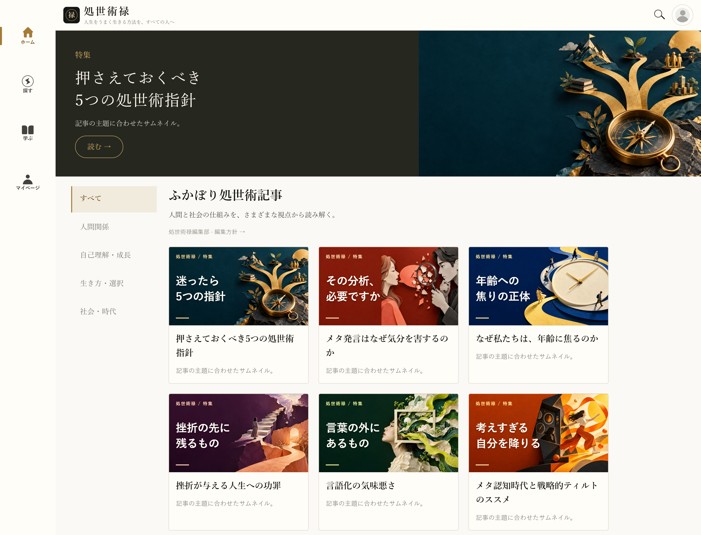
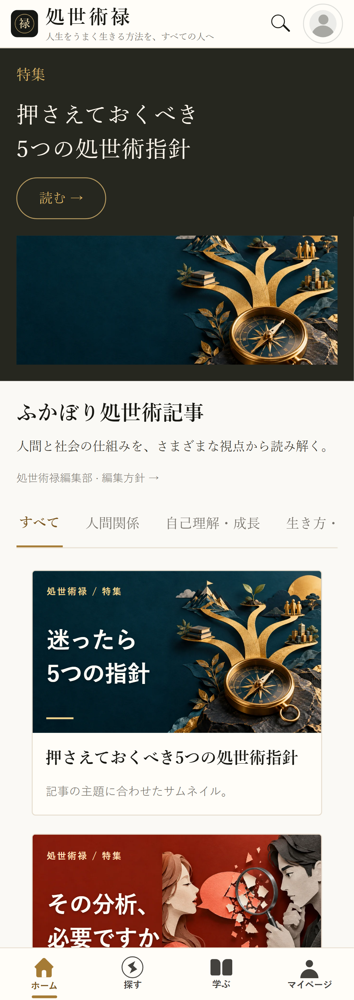

# 特集サムネイルの個別最適化（2026-10-15）

公開中の6記事を本番データで確認し、記事ごとの概念イラストと短い日本語見出しを作成した。生成は組み込み image_gen ツールを使用（CLI・APIキーは不使用）。生成画像は文字なしで、アプリ側のテキストを重ねる。16:9、1200px幅のWebPに圧縮。

一覧・検索・蔵書は共通のFeatureCardからサムネイルを表示。特集トップのヒーローと切り替え用プレビューにも個別画像を使用する。本文の写真はCMSの既存設定を保持。記事IDで紐付け、CMSでタイトルまたは写真を変更した場合には専用画像・見出しよりCMS設定を優先し、古い内容を表示しない。非公開2記事の状態は変更しない。

## 保存画像と生成プロンプト

## 検証

- TypeScript・リポジトリ全体のESLint: 成功。
- 単体テスト39件: 成功。
- サムネイル・検索・ヘッダー操作のブラウザテスト8件: 成功。
- 320 / 390 / 700 / 1440pxで6枚すべての画像読み込み、見出しの収まり、異なる画像、CMS差し替えの優先を確認。
- Expo Web書き出しと公開ビルド監査: 成功。有料本文指紋2,975個に対して漏出なし。
- 以下の画面証跡は記事通信を固定した検証用データを使用。本文・導入文の代わりに検証用コピーを表示している。

## プロンプト一覧

### five-guidelines

保存先: `assets/features/five-guidelines-cover.webp`

Use case: illustration-story. Asset type: editorial feature thumbnail background for a refined Japanese psychology and life-skills magazine. Generate a single landscape image, 16:9 ratio. Art-directed conceptual editorial collage combining tactile cut-paper shapes and crisp dimensional photographic objects, subtle paper grain, sophisticated and bold, immediately legible at 288px width. Composition: keep left 52% mostly quiet, flat deep color negative space for large Japanese headline to be added in code. The main conceptual motif occupies right 48%, with a strong silhouette and edge-to-edge art direction. No text, letters, numbers, logos, watermarks, border, or UI. No generic scenery or business stock photos. Topic: five practical guidelines for navigating life, creating options, trust and several supports. Deep midnight teal and warm brass-gold. On the right an elegant brass compass seen obliquely with five distinct branching golden paths reaching into space, like a compact sculptural map. Precise, calm, quietly empowering. Left side deep teal.

### meta-comments

保存先: `assets/features/meta-comments-cover.webp`

Use case: illustration-story. Asset type: editorial feature thumbnail background for a refined Japanese psychology and life-skills magazine. Generate a single landscape image, 16:9 ratio. Art-directed conceptual editorial collage combining tactile cut-paper shapes and crisp dimensional photographic objects, subtle paper grain, sophisticated and bold, immediately legible at 288px width. Composition: keep left 52% mostly quiet, flat deep color negative space for large Japanese headline to be added in code. The main conceptual motif occupies right 48%, with a strong silhouette and edge-to-edge art direction. No text, letters, numbers, logos, watermarks, border, or UI. No generic scenery or business stock photos. Topic: why unsolicited psychological analysis hurts a conversation. Coral red, pale ivory and graphite. On the right, two sculptural paper human profiles facing each other; a warm coral speech bubble from one is intercepted and dissected by a cool graphite magnifying glass held by the other; small paper fragments imply the warmth of conversation being lost. Thoughtful rather than hostile. Left side solid deep rust-red.

### the-secret-behind-age

保存先: `assets/features/the-secret-behind-age-cover.webp`

Use case: illustration-story. Asset type: editorial feature thumbnail background for a refined Japanese psychology and life-skills magazine. Generate a single landscape image, 16:9 ratio. Art-directed conceptual editorial collage combining tactile cut-paper shapes and crisp dimensional photographic objects, subtle paper grain, sophisticated and bold, immediately legible at 288px width. Composition: keep left 52% mostly quiet, flat deep color negative space for large Japanese headline to be added in code. The main conceptual motif occupies right 48%, with a strong silhouette and edge-to-edge art direction. No text, letters, numbers, logos, watermarks, border, or UI. No generic scenery or business stock photos. Topic: anxiety about age and society's invisible life deadlines, a social clock. Cobalt blue and pale butter-yellow. On the right, a large surreal cream analog clock with hands but NO numerals or markings; several tiny paper-cut people walk at different paces along separate curved paths around it. One person calmly steps off the clock's circular track onto their own golden path. Left side deep cobalt navy, quiet.

### be-broken

保存先: `assets/features/be-broken-cover.webp`

Use case: illustration-story. Asset type: editorial feature thumbnail background for a refined Japanese psychology and life-skills magazine. Generate a single landscape image, 16:9 ratio. Art-directed conceptual editorial collage combining tactile cut-paper shapes and crisp dimensional photographic objects, subtle paper grain, sophisticated and bold, immediately legible at 288px width. Composition: keep left 52% mostly quiet, flat deep color negative space for large Japanese headline to be added in code. The main conceptual motif occupies right 48%, with a strong silhouette and edge-to-edge art direction. No text, letters, numbers, logos, watermarks, border, or UI. No generic scenery or business stock photos. Topic: losing the future self you expected after a serious setback; grief and possible new paths, without glorifying hardship. Rich plum purple and warm peach. On the right, an upward paper staircase ends in a torn gap; a small solitary figure pauses before it; below, a different softly lit peach path bends into an unknown opening. Dramatic but humane, not a cheerful easy-success metaphor. Left side deep aubergine.

### verbalization

保存先: `assets/features/verbalization-cover.webp`

Use case: illustration-story. Asset type: editorial feature thumbnail background for a refined Japanese psychology and life-skills magazine. Generate a single landscape image, 16:9 ratio. Art-directed conceptual editorial collage combining tactile cut-paper shapes and crisp dimensional photographic objects, subtle paper grain, sophisticated and bold, immediately legible at 288px width. Composition: keep left 52% mostly quiet, flat deep color negative space for large Japanese headline to be added in code. The main conceptual motif occupies right 48%, with a strong silhouette and edge-to-edge art direction. No text, letters, numbers, logos, watermarks, border, or UI. No generic scenery or business stock photos. Topic: the unease of putting everything into words; emotional reality exceeds neat explanations. Forest green and acid chartreuse with ivory. On the right, an expressive flowing multicolored paper cloud is pressed through a rigid small rectangular speech-bubble frame; the vibrant irregular emotion spills beyond the tidy frame. An elegant surreal collage, intelligent and slightly uncanny. Left side deep forest green.

### metacognition

保存先: `assets/features/metacognition-cover.webp`

Use case: illustration-story. Asset type: editorial feature thumbnail background for a refined Japanese psychology and life-skills magazine. Generate a single landscape image, 16:9 ratio. Art-directed conceptual editorial collage combining tactile cut-paper shapes and crisp dimensional photographic objects, subtle paper grain, sophisticated and bold, immediately legible at 288px width. Composition: keep left 52% mostly quiet, flat deep color negative space for large Japanese headline to be added in code. The main conceptual motif occupies right 48%, with a strong silhouette and edge-to-edge art direction. No text, letters, numbers, logos, watermarks, border, or UI. No generic scenery or business stock photos. Topic: stepping from spectator into participant, strategic immersion instead of over-monitoring oneself. Burnt orange, electric amber and charcoal. On the right, a paper-cut person leaves a dark geometric observation booth with abstract circular instrument dials (no text) and steps into a warm luminous stage with an energetic flowing ribbon suggesting play and absorbed action. Dynamic diagonal composition, human and joyful but grounded. Left side deep burnt orange.
