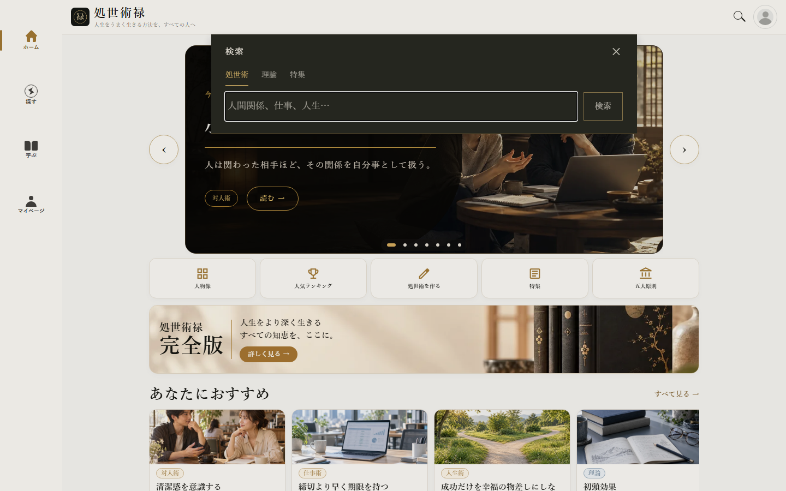
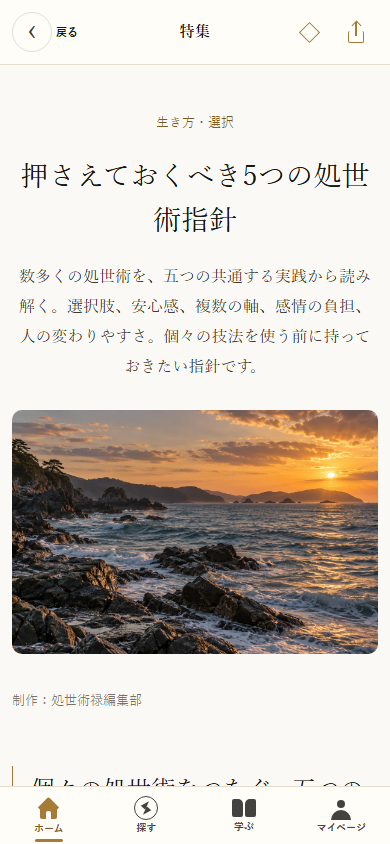

# ヘッダー検索と特集の操作統一

- ヘッダーの検索アイコンは、元のページを保ったままヘッダー直下へ検索ポップアップを開く。
- 暗い背景と金色の下線・検索ボタンを採用。検索対象は「処世術」「理論」「特集」。理論一覧・特集一覧では対応する対象を初期選択する。
- 入力フォーカス、Enter検索、空欄の抑止、閉じるボタン、外側タップ、Escape、Androidの戻る、閉じた後のフォーカス復帰に対応。
- 検索実行後は検索語・対象をURLへ保持。結果ページも同じ3対象に統一。旧人物像モードのURLは処世術にフォールバックする。
- 特集は公開済み記事のタイトル・導入文・本文・分類をAND検索する。下書き・非公開記事は対象外。通信エラー時は再読み込みを案内する。
- 特集詳細の蔵書保存と共有を、処世術・理論と同じ共通ヘッダーへ統合。本文と一覧カードにあった保存ボタンは削除。
- 保存先は従来のsavedFeatureIdsを使用し、既存の保存・蔵書表示と互換。共有は記事URLを含め、Web Share非対応ブラウザーではリンクをコピーする。キャンセルをエラー表示しない。

## 検証

- TypeScript、変更ファイルのESLint、Expo Web書き出し：成功。
- 検索・特集操作のブラウザテスト6件：成功。320px・390px・1440px、対象選択、URL復元、エラー表示、下書き除外、保存復元、共有／リンクコピーを確認。
- 既存ヘッダー・理論一覧検索・特集閲覧の回帰テスト3件：成功。
- PWA上部設定の回帰テスト1件：成功。
- 既存カタログと検索の単体テスト19件：成功。
- 公開ビルド監査：1,636ファイル・2,975個の有料本文指紋を照合し、漏出なし。

画面確認：

iOS実機でのソフトウェアキーボード・ネイティブ共有シートは未確認。実装はReact Native共通コンポーネントで、ネイティブの戻る操作とiOSのキーボード回避に対応する。
